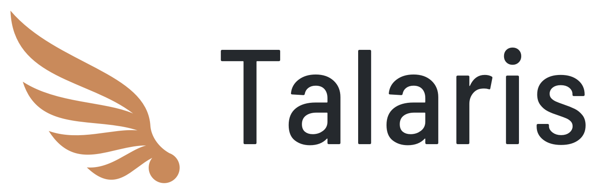
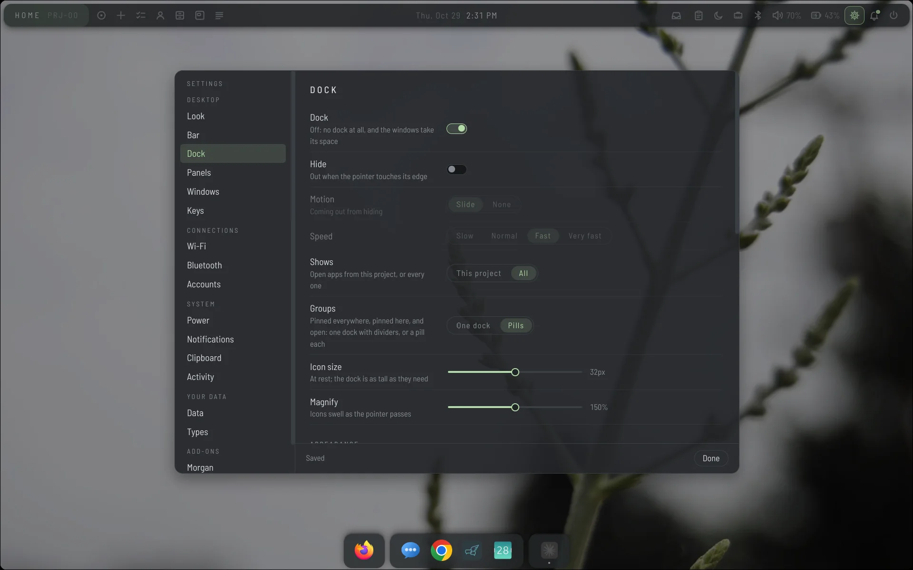
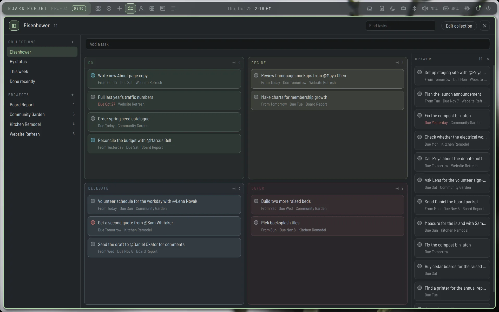

<h1>
  <picture>
    <source media="(prefers-color-scheme: dark)" srcset="design/logo/talaris-logo-on-dark.png">
    
  </picture>
</h1>

**A thinking-space desktop for Hyprland, with an AI assistant built in.**

"Talaris" is Latin, meaning "of or pertaining to the ankle or heel." It
refers to the magical sandals of Hermes/Mercury, the messenger god.

Talaris is a desktop for Hyprland that rethinks the files/folders/icons paradigm, 
and focuses on helping you work and think. It has built-in note-taking, 
infinite canvas, AI assistant (via Ollama and/or Claude), calendars, contacts, and more, all
linking and referring and speaking to one another across different workspaces
for each of your projects.

***Key features:***
- task management with different kinds of visualizations, including boards/matrices
- a Markdown note-taker supporting wikilinks, tags, file attachments, and more
- a full contacts module
- a "library" app that rethinks the file manager into a place to store and connect all of your stuff
- a full and fully integrated calendar app
- support for plugins
- all of the above is interoperable and integrated with the system, launcher, and one another
- an AI assistant that does a lot of things (see below)
- workspaces for each project, each with their own dock, wallpaper, notes, and more
- scheduled backups
- integrated clipboard history
- an attempt at a standardized spec/format for PKMS items (tasks, events, etc.) so that you can connect it to other apps
- attractive, minimalist theming with a few interesting animation options

**Important notes**

This is 99% vibe-coded with Claude, primarily Opus 5.5. The other 1% is 
mostly me hitting Copy/Paste and scratching my head on better questions 
to ask.

I'm running and building this in Ubuntu 26.06 and Hyprland on a Dell
XPS 13 laptop. I haven't tested on any other distribution or machine.

Some of this was built to sync with my home-grown notes/Notion/etc. thing,
also vibe-coded. It should work fine without that, though. I've turned that
into a plugin.

In others words, taking all of the above into consideration, your mileage
may vary. You're entering the crazy, maze-like brain folds of a dedicated
tinkerer. I mean, I took toasters apart as a kid and usually failed to
put them back together into working things. But Talaris is working for me.

**Media**

  
  

More screenshots: [docs/SCREENSHOTS.md](docs/SCREENSHOTS.md).

**AI Assistant**

Talaris includes Morgan, an AI assistant that's available via voice ("Hey Morgan!"
or whatever you want to call it), keystroke, and bar icon.

Morgan runs through Ollama, and can use Claude as a bakcup (as "the Oracle").
I'm also working on a separate app that you can run on a server, so
that you can support multiple devices interacting with a centralized Morgan.

Morgan offers:
- full MCP support
- tracking (if you want) of your work for suggestions on how to be more productive
- tracking, ingesting, and embedding everything on your system to help identify related things
- full awareness of notes, contacts, calendar events, etc., etc.
- ability to work in all of those modules to do things like:
  - "Put all of the tasks in the 'Do' box of my Eisenhower matrix on a canvas."
  - "Look at my calendar and tasks and give me some suggestions on staging my day."
  - "Take a look at everything you can find about my friend Rich and suggest a birthday present."

**Not built yet.** 

See [DESIGN.md](DESIGN.md). 

Also, I'm considering but still a bit lost on best ways to integrate email.

**Under the Hood***

Talaris is two processes and a set of pages.

- **The core** (`packages/core`) — TypeScript on Node. It keeps everything:
  projects, pages, canvases, tasks, people, events, notes and files, as
  entities in the shape of the [pkm-interchange](https://github.com/jpmoo/hermesnotes/tree/main/pkm-interchange)
  format. It serves a Unix socket (`$XDG_RUNTIME_DIR/talaris.sock`) that
  everything else talks to, hosts plugins, and offers the entity graph over
  MCP for Morgan or any other MCP client started on this machine. It has no
  runtime dependencies beyond Node itself. It runs as a systemd user
  service, `talaris-core`, so it outlives anything on screen.
- **The surfaces** (`surfaces/`) — one PySide6 process that draws the bar,
  the dock, the panels (Tasks, People, Library, Calendar, Glance, Archive,
  New), the canvas and writing drawers, the launcher, notifications,
  Settings and Morgan's panel, as Wayland layer-shell surfaces. Each is an
  HTML page in QtWebEngine, served from a private URL scheme and connected
  to the process by a `QWebChannel`. It talks to Hyprland over its sockets
  and to the core over its own. It runs as `talaris-surfaces`, which
  restarts if it falls over.
- **The pages** (`surfaces/ui/`) — plain HTML, CSS and JavaScript with no
  build step, drawn from one set of shared files: `tokens.css` (every
  colour, corner, shadow and timing), `controls.css`, `kit.css`/`kit.js`
  (menus, pickers, asking twice, dragging), `icons.js`. A check that runs
  with the tests fails when a page writes a value of its own.
- **The editor and the canvas** (`packages/editor`, `packages/canvas`) —
  TypeScript, bundled into `surfaces/ui/`: CodeMirror for writing, and the
  canvas forked from Hermes Notes.
- **Morgan**, the voice and chat assistant, is its own project
  ([heymorgan](https://github.com/jpmoo/heymorgan)) and its own service.
  Talaris shows its panel and gives it the entity graph; it does not need
  Morgan to run.
- **Plugins** are separate processes in any language, spoken to over MCP on
  their standard input and output. Each declares in a `plugin.toml` what it
  may read, change and do before it is enabled. How to write one: [PLUGINS.md](PLUGINS.md);
  the shape Talaris's data is shared in: [PKM-INTERCHANGE.md](PKM-INTERCHANGE.md).

Hyprland's own configuration stays yours: the installer writes a
`talaris.conf` beside it, and one `source =` line in `hyprland.conf` turns
Talaris on. Binds are made at runtime, so taking that line out takes Talaris
out.

**What it needs**

- **Linux with Hyprland**, and `hyprpaper`, `hypridle`/`hyprlock` and
  `hyprpolkitagent` beside it.
- **Node 22 or later** and **pnpm**, for the core and the bundles.
- **Python 3 with PySide6** (QtWebEngine and layer-shell support), and
  **PyGObject** for the keyring (libsecret), and for calendars and contacts
  through Evolution Data Server (`EDataServer`, `ECal`, `EBook`).
- **A login keyring** (GNOME Keyring or another Secret Service), unlocked at
  login: it holds the key everything is sealed with.
- **systemd** user services.
- The usual desktop tools, each only for what it reads or sets:
  `wl-clipboard` (clipboard history), `grim` (project thumbnails),
  `nmcli` (Wi-Fi), `bluetoothctl`, `wpctl` (PipeWire volume), `upower` and
  `powerprofilesctl` (battery and power mode), `brightnessctl`,
  `notify-send`.

`./install.sh` builds everything, installs and starts the services, and
writes `talaris.conf`; one `source =` line in your `hyprland.conf` turns it
on. [examples/hyprland.conf](examples/hyprland.conf) is an annotated
starting point: what stays yours, and what to leave out because Talaris
does it.

**How security is handled**

- **Everything stored is sealed.** Entities, their attached files, the
  clipboard history and backups are encrypted on disk with
  AES-256-GCM, a fresh nonce each time. The key is 32 random bytes kept in
  the login keyring, never in a file.
- **A recovery key, shown once.** The store's key is also kept sealed to a
  recovery key (X25519) whose private half Talaris never keeps: write it
  down or put it in a password manager. If the keyring is lost, the recovery
  key opens the sealed copy. A locked or missing keyring leaves the store
  *locked*, never empty: a new key is never made over existing data.
- **Backups** are the whole store as an interchange export, sealed to the
  recovery key and written to a folder you choose, on a schedule. Sealing
  needs only the public half, so backups run unattended and nothing on the
  machine can open one; restoring asks for the recovery key.
- **Projects can be encrypted too**, one by one (Settings → Data). Then the
  pages, files and canvases Talaris writes into the project's folder are
  sealed as well. Not by default, because a project is an ordinary folder
  other applications save into; file names, and what other applications
  save there, are left to the disk's own encryption.
- **Nothing listens on the network.** The core's socket is readable and
  writable by you alone (mode 0600). The MCP server speaks only on standard
  input and output, so only something you started can reach it.
- **Each page reaches only what it needs.** A page asks the core through its
  bridge, and the bridge passes on only that page's own routes: the bar's
  popups cannot install a plugin or open the vault. A path the core would
  read differently from how it is written is refused.
- **Plugins say what they may do, and are held to it.** A plugin's manifest
  names the kinds of things it may read and change and whether it may
  notify; Talaris shows that before it is enabled and refuses anything
  outside it. A plugin is still a program running as you: Talaris cannot
  stop it reading files or using the network, and says so. Plugins' secrets
  go in the keyring.
- **Secrets stay out of the clipboard history.** What a password manager
  marks as secret is never read, and the recovery key, copied from
  Settings, is left out.
- **What leaves the machine is what you point it at:** the sync plugins'
  servers, the address set for search by meaning, and Morgan's brain where
  you run it.

**License**

GPL-3.0-only — see [LICENSE](LICENSE). Also available on other terms from the
owner. Contributions need the [Contributor License Agreement](CLA.md); see
[CONTRIBUTING.md](CONTRIBUTING.md).
