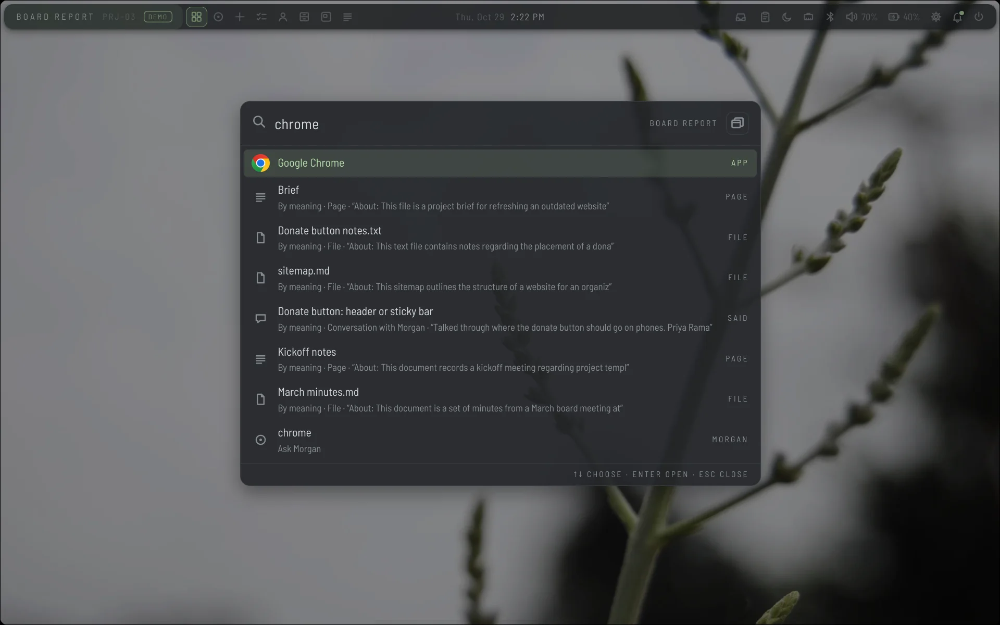
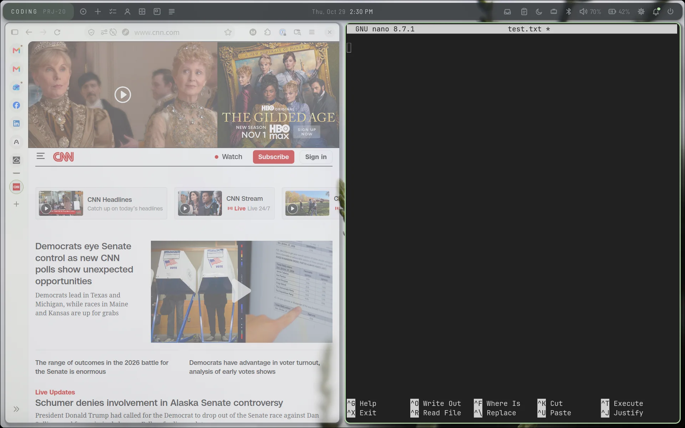
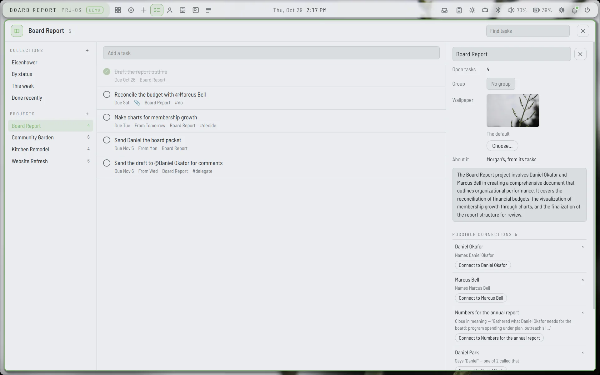
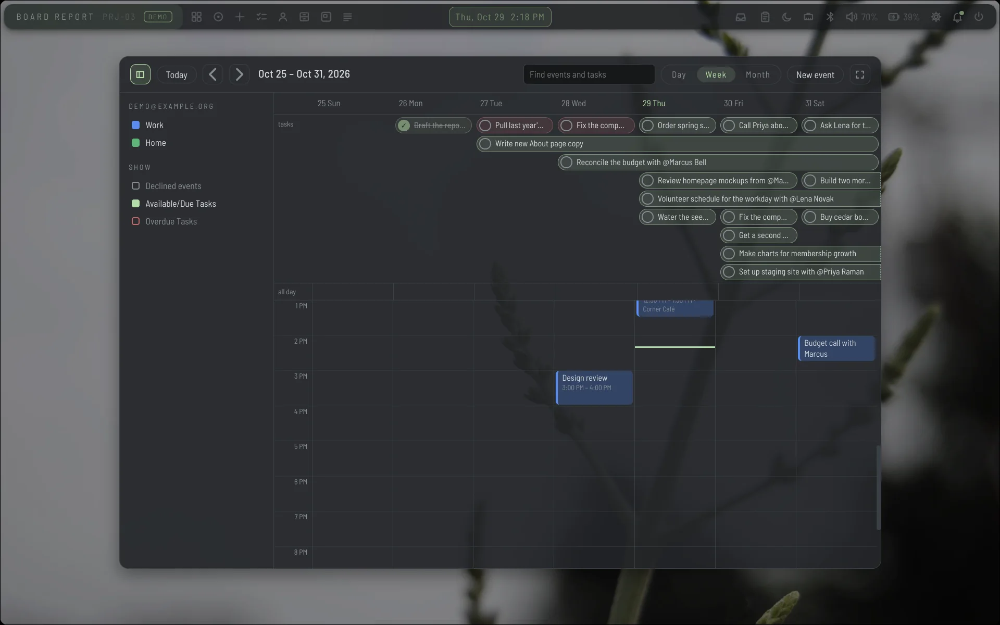
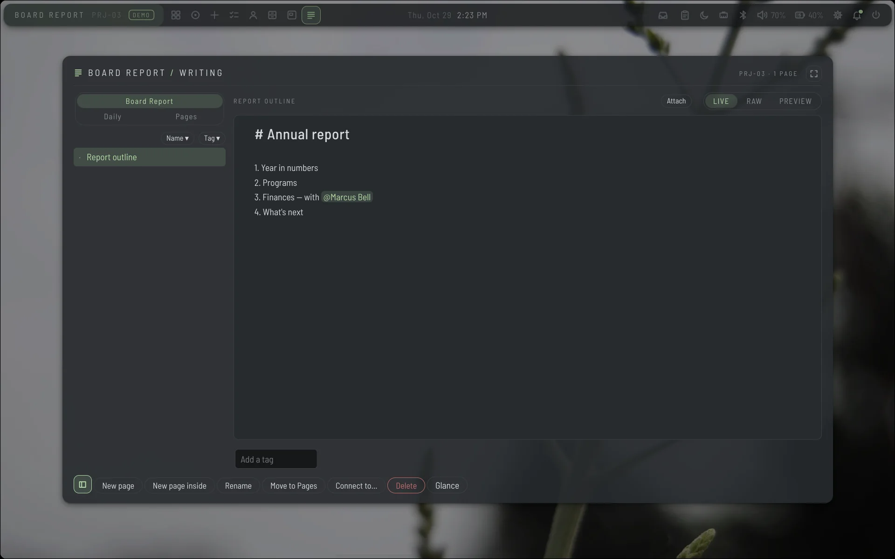
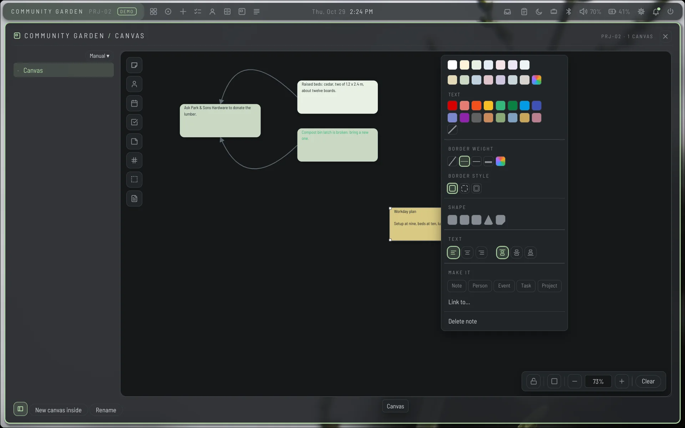
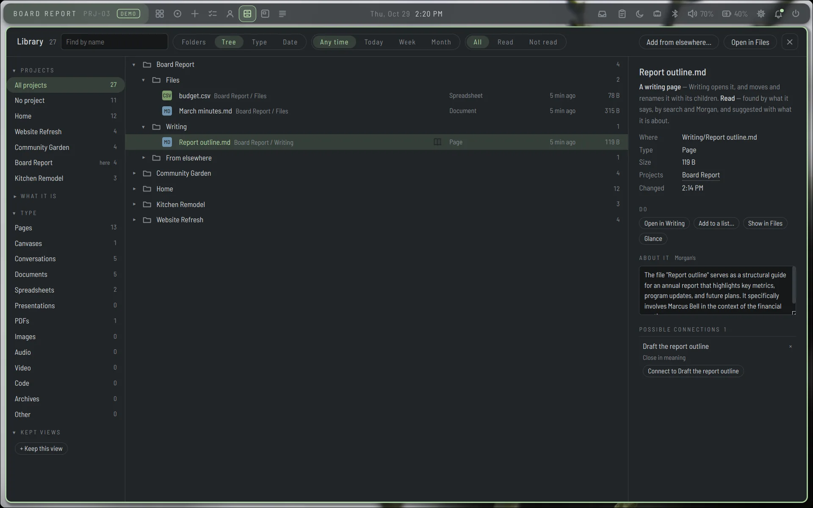
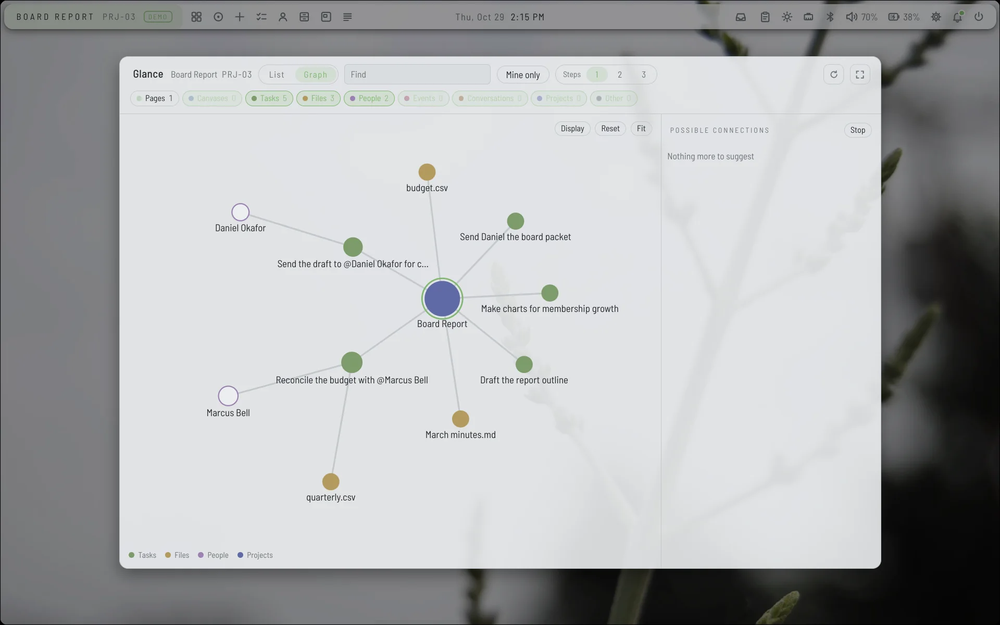
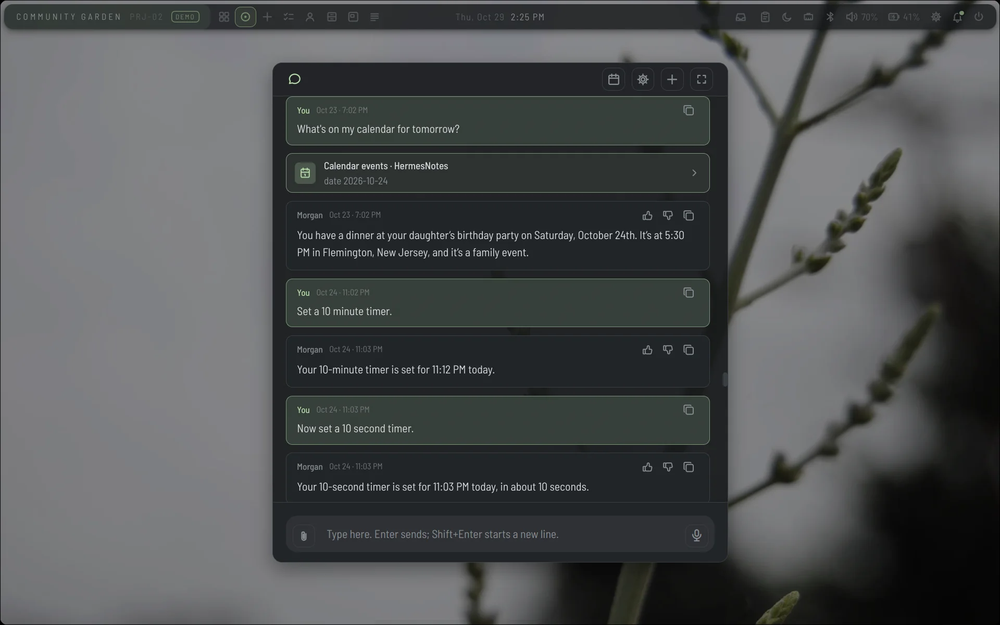
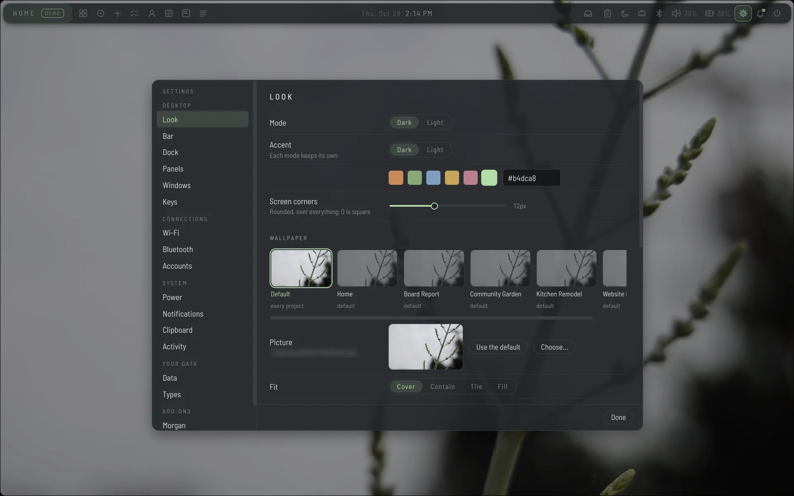

# Talaris, in pictures

Taken in demo mode (Settings, Data): a made-up world of four projects —
a board report, a community garden, a kitchen remodel, a website refresh —
with their people, tasks, pages, files and events.

## The launcher

Super+Space: applications, projects, windows, pages, files, tasks, people and
events, by name or by meaning; Morgan when nothing else fits.

## Windows

Ordinary applications, tiled on each project's own desktop, with the bar
over them.

## Tasks

A project's tasks, with its description and the connections Talaris suggests.

Collections lay tasks out by any rule — here, an Eisenhower matrix across
every project, with a drawer of the rest.

## Calendar

Events from your accounts, with tasks by the days they are available and due.

## Writing and the canvas

Each project's writing drawer: Markdown drawn as you write it, with @ to
name a person, task or event.

Each project's canvas: notes, cards and links, styled from one menu.

## Library

Every project's files in one place, each read, described, and suggested
where it belongs.

## Glance

A project at a glance: everything in it and how it is connected.

## Morgan

The assistant, by voice or by typing: its conversation, with what it looked
up shown as it goes.

## Settings

One place for the whole desktop: its look, the bar, the dock, panels,
windows, keys, connections, power, notifications, your data and add-ons.

The dock — pinned applications, grouped as pills — and its settings.

